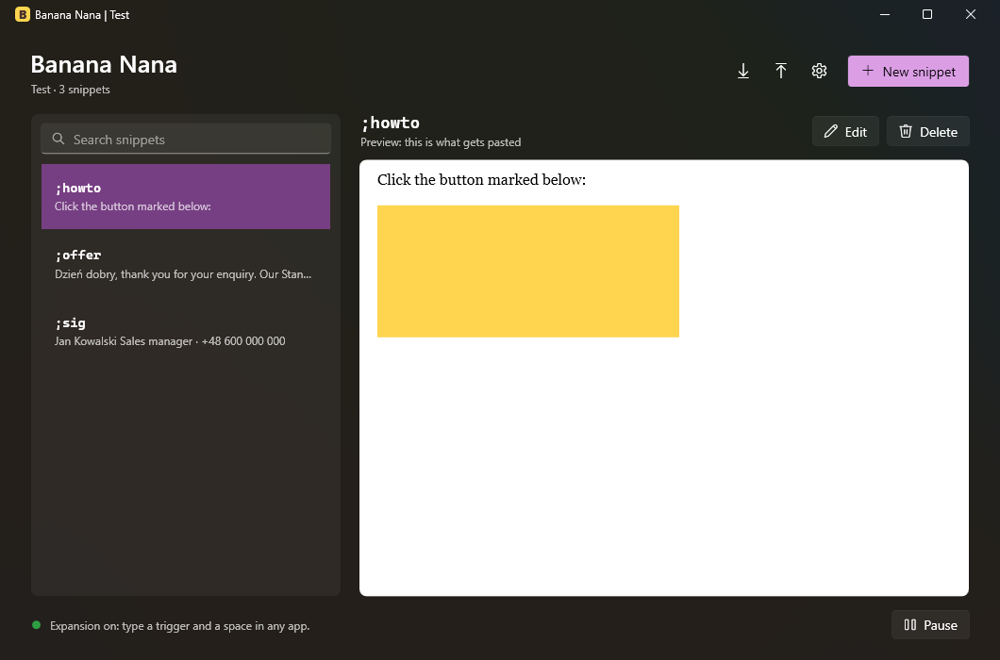
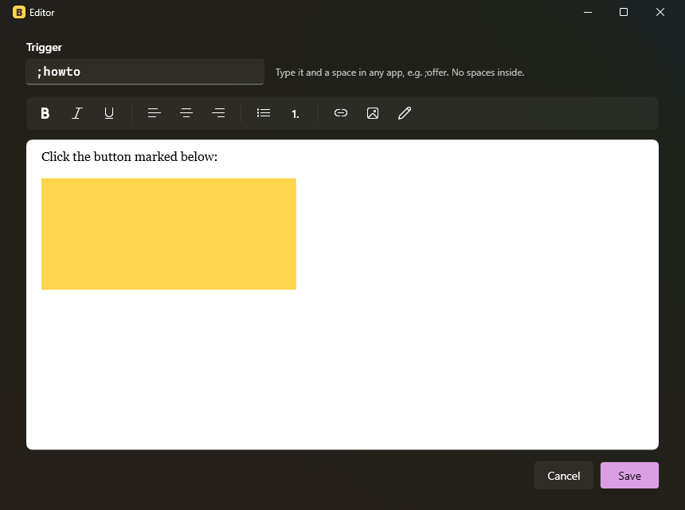
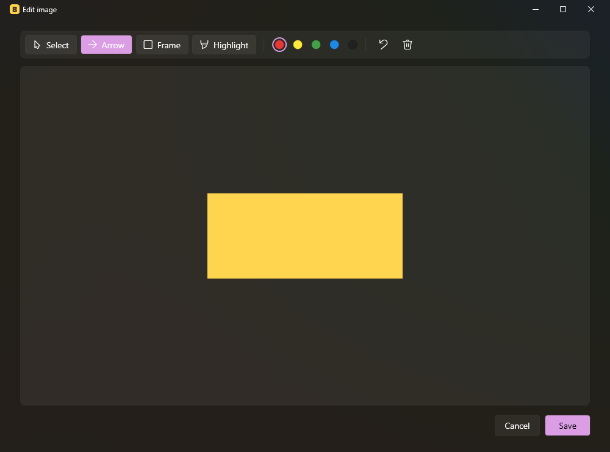

# Banana Nana

A portable text expander for Windows. Type a short trigger such as `;offer` followed by a space in any
app, and Banana Nana replaces it with a saved snippet: formatted text, lists, links and pictures.
No installation and no admin rights.



## Features

- **Expands anywhere**: Word, Outlook, Teams, Notepad, browsers and so on. Trigger + space expands;
  Enter never does, so nothing gets sent by accident.
- **Rich snippets**: bold, italic, underline, alignment, bulleted and numbered lists, links, pictures.
  Pasting from Word keeps the formatting.
- **Pictures**: insert or paste screenshots, resize them by dragging a corner, and draw arrows,
  frames and highlights with the built-in image editor.
- **Clipboard-friendly**: your clipboard is restored after every expansion.
- **Runs in the tray**, optionally starts with Windows, one instance at a time.
- **Seven languages**: English, Polski, Deutsch, Español, Français, ไทย, 简体中文.
- **Help guide, tips and a welcome screen** for new users.
- **Windows 11 look** (Fluent theme, light/dark mode, accent colour).
- **Portable library**: one JSON file, next to the EXE or in `Documents\BananaNana`.

| Editor | Image editor | Welcome guide (Chinese) |
|---|---|---|
|  |  |  |

## Documentation

- [User guide](docs/USER_GUIDE.md): using the app, tips, troubleshooting
- [Architecture](docs/ARCHITECTURE.md): how it works, project layout, testing, adding a language
- [Paste compatibility](docs/COMPAT.md): which clipboard formats work in which apps, and why
- [Research](docs/RESEARCH.md) and [original plan](docs/PLAN.md): background decisions

## Build

Requires Windows 10 or 11 (64-bit) and the .NET 10 SDK.

```
dotnet build
dotnet test
dotnet run --project BananaNana
```

`tools/PasteLab` is a test bench for clipboard formats and live expansion.

### Single-file EXE

Two variants. Delete `BananaNana/obj/Release` between the two publishes, or the second may reuse the first one's settings.

**Standalone** (about 66 MB, .NET included, runs on any 64-bit Windows 10/11):
```
dotnet publish BananaNana/BananaNana.csproj -c Release -r win-x64 --self-contained true -p:PublishSingleFile=true -p:IncludeNativeLibrariesForSelfExtract=true -p:EnableCompressionInSingleFile=true -p:DebugType=none -o publish/standalone
```

**Small** (about 0.4 MB, needs the free [.NET Desktop Runtime 10](https://dotnet.microsoft.com/download) installed once; without it Windows shows a download link):
```
dotnet publish BananaNana/BananaNana.csproj -c Release -r win-x64 --no-self-contained -p:PublishSingleFile=true -p:DebugType=none -o publish/small
```

Trimming is not used: Microsoft does not support it for WPF, and it was tested and found to break the app
(see [Architecture](docs/ARCHITECTURE.md#build-and-release)).

## Status

Working: editor, library, live expansion (verified in Word, Teams and Notepad), images, links, tray,
start with Windows, languages, help, single-file EXE.

Not done yet:
- Safety checks: skip password fields, warn when an elevated (admin) app blocks the paste, excluded apps list
- Select-option fields (pick a variant when a snippet expands)
- Outlook paste verified only indirectly (it uses Word's editor); confirm by hand
- Thai and Chinese translations are not yet reviewed by native speakers
