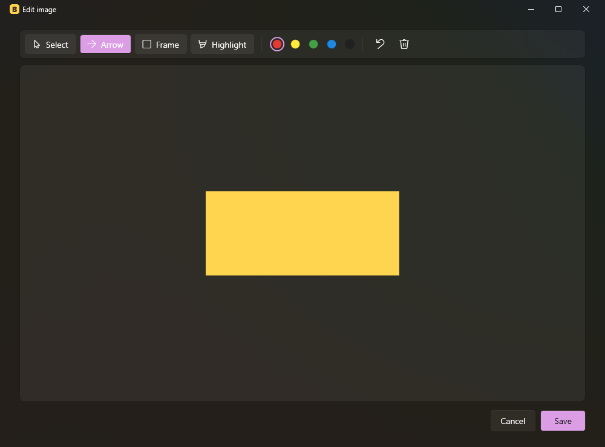

# Banana Nana: user guide

## Getting started

1. Run `BananaNana.exe`. On first start a short welcome guide opens; pick your language at the top right.
2. Click **New snippet**.
3. Enter a **trigger**, for example `;offer`. Start triggers with a symbol such as `;` or `/` so they never
   appear inside normal words. Triggers cannot contain spaces and are not case-sensitive.
4. Write or paste the content and click **Save**.
5. In any app, type the trigger followed by a **space**. The trigger disappears and the snippet is pasted.

Enter, Tab and other keys never expand a trigger. This is deliberate: in Teams, Enter sends the message.

## The editor

| Action | How |
|---|---|
| Bold, italic, underline | Toolbar or Ctrl+B / Ctrl+I / Ctrl+U |
| Align left, center, right | Toolbar or Ctrl+L / Ctrl+E / Ctrl+R |
| Bulleted / numbered list | Toolbar |
| Link | Select text, click the link button or press Ctrl+K. Ctrl+click a link to open it |
| Paste from Word | Ctrl+V keeps formatting, lists and pictures |
| Insert picture | Toolbar, or paste a screenshot with Ctrl+V |
| Resize picture | Click it, then drag a corner (proportions stay locked) |
| Draw on picture | Double-click it (or select it and click the pencil button) |

The content area is always white, like paper, so you see the snippet as it will look in Word or Teams.
Fonts are not carried over: the pasted text takes the target app's own font.

Links can be web addresses (`https://...`, or just `example.com`) or email addresses (`name@example.com`).
Other kinds of links are not allowed.

### Image editor

- **Arrow**: drag from the tail to the tip.
- **Frame**: drag to draw a rectangle.
- **Highlight**: drag freely, like a highlighter pen.
- **Select**: click a shape to select it, drag to move it, press Delete to remove it.
- Five colours, **Undo** (Ctrl+Z). **Save** merges the drawings into the picture; **Cancel** discards them.

Pictures are pasted at the size you see in the editor, so shrink large screenshots before saving.

## The main window

- **Search** filters snippets as you type.
- **Edit** / **Delete** act on the selected snippet (double-click also opens it).
- **Pause** stops expansion until you resume it. The dot in the status bar is green when on, orange when paused.
- The **?** button opens the help guide and tips.

## Tray and start with Windows

Closing the window does not quit Banana Nana; it keeps running in the tray (the yellow **B** near the clock).

- Left-click the icon to open the window.
- Right-click for **Pause expansion**, **Start with Windows** and **Exit**.

**Start with Windows** (tray menu or Settings) starts Banana Nana quietly in the tray when you sign in.
It needs no admin rights. Starting Banana Nana a second time only brings up the copy that is already running.

## Languages

Settings (gear icon) → **Language**, or the picker in the welcome/help window. The change applies immediately.
Only the app's own text changes; snippets are never translated.

## Your library

Snippets are stored in `BananaNana.library.json`:

- next to `BananaNana.exe` (portable, e.g. on a USB stick), or
- in `Documents\BananaNana`.

If both exist, Banana Nana asks which one to open. **Export** saves a copy anywhere (backup or sharing);
**Import** opens another library file. Settings shows where the current library is and opens its folder.

App preferences (language, whether the welcome guide was shown) are in `%APPDATA%\BananaNana\settings.json`.

## Troubleshooting

| Problem | Cause / fix |
|---|---|
| "Windows protected your PC" on first run | The EXE is not code-signed. Click **More info → Run anyway**. |
| Antivirus warns about the app | It watches the keyboard to detect triggers. It only keeps the word being typed, in memory, never a key history. Add an exception if needed. |
| Nothing happens in one particular app | If that app runs as administrator, Windows blocks input from normal apps. Run that app normally, or (not recommended) run Banana Nana as administrator too. |
| Trigger expands twice / clipboard gets mixed up | Two copies are running (for example an old version). Exit all of them from the tray and start one. |
| Picture missing in Teams | Very large pictures used to fail; they are now sent at their displayed size. Shrink the picture in the editor if it still happens. |
| The small EXE does not start | Install the free .NET Desktop Runtime 10 from https://dotnet.microsoft.com/download, or use the standalone EXE. |
| I need to type a trigger literally | Pause expansion (tray icon or Pause button), type it, resume. |

## Tips

- Start triggers with `;` or `/` so they never clash with real words.
- Your clipboard is restored after each paste, so copy and paste keep working as usual.
- Export your library regularly as a backup.
- Put `BananaNana.library.json` next to the EXE to carry your snippets on a USB stick.
- Ctrl+click a link in the editor to check where it goes.
